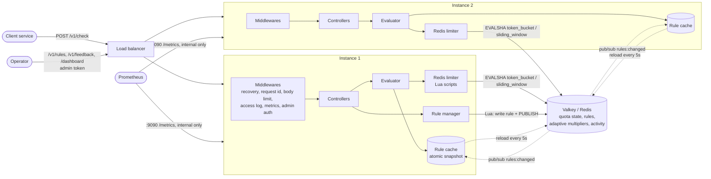
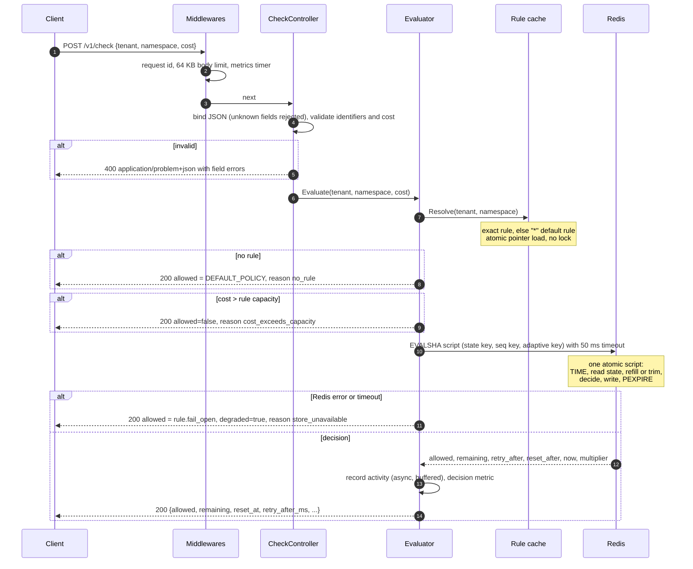
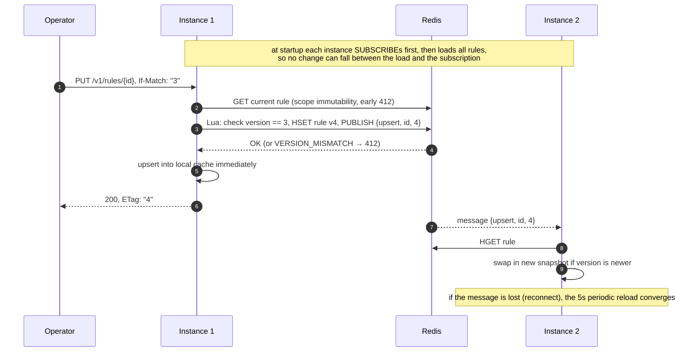
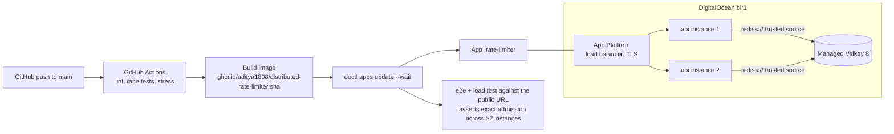

# Architecture

The service answers one question at high volume: *may this tenant make one more
request to this namespace right now?* Every instance is stateless; all quota
state and all rules live in one shared Redis-compatible store (Valkey on
DigitalOcean, Redis locally). Correctness across instances comes from doing every
read-modify-write inside the store as a single atomic Lua script, using the
store's own clock.

## Components

Package responsibilities:

| Package | Responsibility |
|---|---|
| `routes` | Route table; public, admin (auth-gated) and internal (`/metrics`) groups |
| `middlewares` | Cross-cutting HTTP concerns, all problem+json on failure |
| `controllers` | Bind and validate input, call a manager, map the result to a schema |
| `schemas` | Wire request/response types, separate from domain types |
| `manager` | Business logic: evaluate, rule CRUD, adaptive limits, activity |
| `limiter` | Algorithms: Lua scripts for Redis plus an in-memory Go reference |
| `cache` | Lock-free in-process rule snapshot kept in sync via pub/sub |
| `persistence` | Store interfaces; `redisstore` implements them |
| `types` | Domain types, validation, sentinel errors |
| `core` | Wiring and lifecycle |

## Request path: `POST /v1/check`

The check endpoint returns `200` for both allow and deny. A deny is a successful
answer, not an HTTP error: the *caller* turns it into its own `429` for its own
client. Errors (`400`, `413`, `503`) mean the question itself could not be
answered.

## Rule changes

State keys include the rule version (`rl:{tenant|ns}:<ruleID>:v<version>`), so
an updated rule starts a fresh bucket instead of reinterpreting counters that
were written under different parameters.

## Data model in Redis

| Key | Type | Purpose | TTL |
|---|---|---|---|
| `rl:{rules}:data` | hash `id → rule JSON` (with `schema_version`) | Rule records | none |
| `rl:{rules}:index` | hash `tenant\|ns → id` | One rule per scope (HSETNX) | none |
| `rl:rules:changed` | pub/sub channel | Change events | n/a |
| `rl:{t\|ns}:<id>:v<n>` | hash `{tokens, ts}` | Token bucket state | until full again |
| `rl:{t\|ns}:<id>:v<n>` | sorted set `member → ms` | Sliding window log | window |
| `rl:{t\|ns}:<id>:v<n>:seq` | counter | Unique sorted-set members | window |
| `rl:{t\|ns}:adaptive` | string multiplier | Adaptive tightening | feedback TTL |
| `rl:activity` | sorted set `t\|ns → last seen` | Dashboard | trimmed to 1h |

Everything a script touches for one decision shares the `{tenant|ns}` hash tag,
so the same scripts run unchanged on Redis Cluster.

## Correctness under contention

| Race window | How it is closed or bounded |
|---|---|
| Two instances check the same key at the same instant | Each decision is one Lua script; Redis executes scripts one at a time, so read-decide-write cannot interleave. Proven by tests: 500 concurrent requests against a burst of 50 admit exactly 50 (a naive GET-then-SET limiter admits all 500). |
| Instance clocks disagree | No instance clock is used. Scripts read `TIME` from Redis, the single clock for every decision. A clock moving backwards after failover is clamped (no negative refill). |
| Rule update reaches instances at different times | Pub/sub delivers in milliseconds; a lost message is repaired by the periodic reload (`RULE_REFRESH_INTERVAL`, default 5 s). During that window an instance can enforce the previous version, so worst case is old burst + new burst admitted once. |
| Concurrent rule writes | Create uses `HSETNX` on the scope index (exactly one wins → 409 for the rest). Update compares the stored version inside the script (optimistic concurrency, `If-Match`/`ETag`, 412 on mismatch, 428 if missing). |
| Cache update races (pub/sub vs reload vs local write) | Snapshots are immutable and swapped with an atomic pointer; writers are serialized and only ever move a rule to a *higher* version. |
| Script cache flushed (failover, `SCRIPT FLUSH`) | `EVALSHA` falls back to `EVAL` on `NOSCRIPT`; covered by a test that flushes scripts mid-run. |
| Redis slow or down | Every store call has a hard timeout (`REDIS_TIMEOUT`, 50 ms). The decision degrades to the rule's `fail_open` setting and is marked `degraded: true`; readiness turns red so the load balancer can react. |
| Store call times out after the script already ran | A timeout is ambiguous: the token may be consumed while the caller gets a degraded deny. This can only *under*-admit (one token per degraded response), never over-admit. It's kept rare by pre-dialing connections (`REDIS_MIN_IDLE_CONNS`) so bursts don't pay TLS dials inside the deadline. The e2e and load tests assert `allowed ≤ burst` and `allowed ≥ burst − degraded`. Seen once in production right after a deploy, when the connection pools started empty. |
| Redis failover with async replication | Writes not yet replicated are lost; affected counters restart, which can admit up to one extra burst per key. This is the standard trade-off for an in-memory limiter and is documented as a limitation. |
| Floating-point drift in token refill | Token counts are rounded to 6 decimals with an epsilon compare; contract tests check the Lua scripts against the Go reference implementation scenario by scenario. |

## Deployment topology (DigitalOcean)

