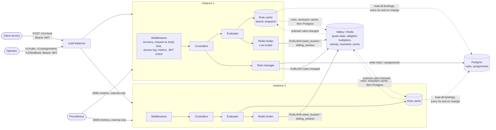
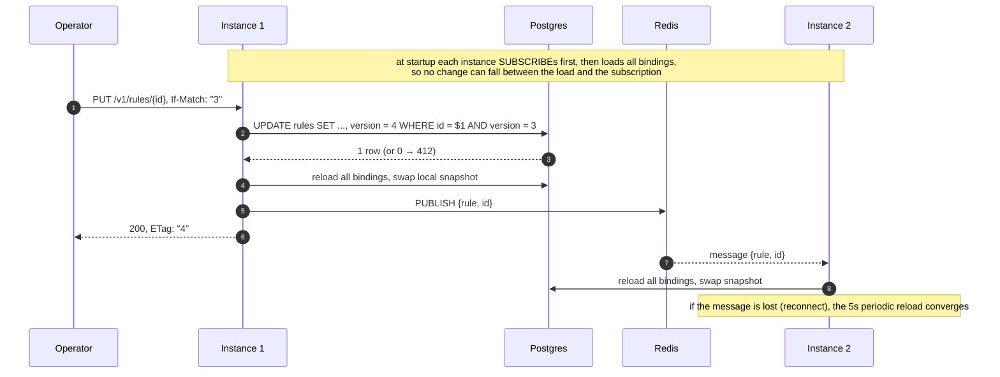
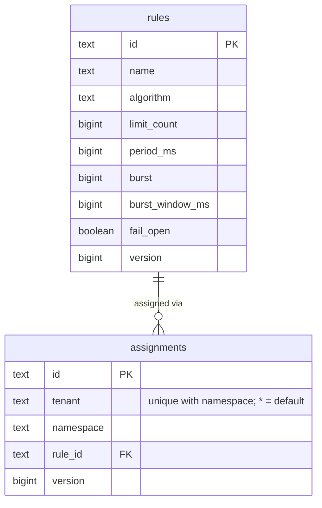
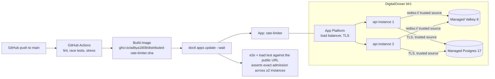

# Architecture

The service answers one question at high volume: *may this tenant make one more
request to this namespace right now?* Every instance is stateless; all quota
state lives in one shared Redis-compatible store (Valkey on DigitalOcean, Redis
locally). Correctness across instances comes from doing every read-modify-write
inside the store as a single atomic Lua script, using the store's own clock.

Rules and assignments are configuration, not hot state, so they live in
Postgres. A **rule** is a reusable limit (algorithm, limit, period, burst,
fail mode) with no scope. An **assignment** binds a `(tenant, namespace)` pair
to a rule; tenant `*` is the namespace default. One rule can serve any number
of pairs. Each instance keeps every binding in memory, so Postgres is never on
the check path in steady state.

## Components



Package responsibilities:

| Package | Responsibility |
|---|---|
| `routes` | Route table; public, admin (auth-gated) and internal (`/metrics`) groups |
| `middlewares` | Cross-cutting HTTP concerns, all problem+json on failure |
| `controllers` | Bind and validate input, call a manager, map the result to a schema |
| `schemas` | Wire request/response types, separate from domain types |
| `manager` | Business logic: evaluate, rule CRUD, adaptive limits, activity |
| `limiter` | Algorithms: Lua scripts for Redis plus an in-memory Go reference |
| `cache` | Lock-free in-process snapshot of all bindings, kept in sync via pub/sub; Redis/Postgres fallback on a miss |
| `persistence` | Store interfaces; `pgstore` (rules, assignments, migrations) and `redisstore` (everything else) implement them |
| `types` | Domain types, validation, sentinel errors |
| `core` | Wiring and lifecycle |

## Request path: `POST /v1/check`

```mermaid
sequenceDiagram
    autonumber
    participant C as Client
    participant M as Middlewares
    participant K as CheckController
    participant E as Evaluator
    participant RC as Rule cache
    participant R as Redis

    C->>M: POST /v1/check {tenant, namespace, cost}
    M->>M: request id, 64 KB body limit, metrics timer
    M->>K: next
    K->>K: bind JSON (unknown fields rejected), validate identifiers and cost
    alt invalid
        K-->>C: 400 application/problem+json with field errors
    end
    K->>E: Evaluate(tenant, namespace, cost)
    E->>RC: Resolve(tenant, namespace)
    Note over RC: exact assignment, else "*" default<br/>atomic pointer load, no lock
    opt neither in the snapshot (safety net)
        RC->>R: GET resolution cache (TTL RULE_MISS_TTL)
        RC->>RC: on a Redis miss: Postgres Resolve, then SET in Redis
        Note over RC: answer, including "no rule", cached locally for RULE_MISS_TTL;<br/>one lookup per pair at a time (singleflight)
    end
    alt no rule
        E-->>C: 200 allowed = DEFAULT_POLICY, reason no_rule
    end
    alt cost > rule capacity
        E-->>C: 200 allowed=false, reason cost_exceeds_capacity
    end
    E->>R: EVALSHA script (state key, seq key, adaptive key) with 50 ms timeout
    Note over R: one atomic script:<br/>TIME, read state, refill or trim,<br/>decide, write, PEXPIRE
    alt Redis error or timeout
        E-->>C: 200 allowed = rule.fail_open, degraded=true, reason store_unavailable
    else decision
        R-->>E: allowed, remaining, retry_after, reset_after, now, multiplier
        E->>E: record activity (async, buffered), decision metric
        E-->>C: 200 {allowed, remaining, reset_at, retry_after_ms, ...}
    end
```

The check endpoint returns `200` for both allow and deny. A deny is a successful
answer, not an HTTP error: the *caller* turns it into its own `429` for its own
client. Errors (`400`, `413`, `503`) mean the question itself could not be
answered.

## Rule and assignment changes



Assignment writes (`POST /v1/assignments`, `PUT` / `DELETE
/v1/assignments/{id}`) follow the same path and also delete the Redis
resolution entry of every pair they touch (both pairs when an update moves an
assignment).
The Postgres commit and the `PUBLISH` are not atomic; if the publish is lost,
the periodic reload converges.

State keys include the rule version (`rl:{tenant|ns}:<ruleID>:v<version>`), so
an updated rule starts a fresh bucket instead of reinterpreting counters that
were written under different parameters. A rule shared by many pairs still
gives each pair its own quota, because the pair is part of the key.

## Data model

Postgres (schema managed by embedded, append-only migrations in
`persistence/pgstore/migrations`, applied at startup under an advisory lock):

| Table | Key | Columns |
|---|---|---|
| `rules` | `id` (`r_<ulid>`) | `name`, `algorithm`, `limit_count`, `period_ms`, `burst`, `burst_window_ms`, `fail_open`, `version`, timestamps |
| `assignments` | `id` (`a_<ulid>`), unique `(tenant, namespace)` | `rule_id` → `rules.id` (`ON DELETE RESTRICT`, so an assigned rule cannot be deleted), `version`, timestamps |



Redis:

| Key | Type | Purpose | TTL |
|---|---|---|---|
| `rl:rules:changed` | pub/sub channel | Rule and assignment change events | n/a |
| `rl:{t\|ns}:resolution` | string, JSON | Shared answer for a snapshot miss, including "no rule" | `RULE_MISS_TTL` |
| `rl:{t\|ns}:<id>:v<n>` | hash `{tokens, ts}` | Token bucket state | until full again |
| `rl:{t\|ns}:<id>:v<n>` | sorted set `member → ms` | Sliding window log | window |
| `rl:{t\|ns}:<id>:v<n>:seq` | counter | Unique sorted-set members | window |
| `rl:{t\|ns}:adaptive` | string multiplier | Adaptive tightening | feedback TTL |
| `rl:activity` | sorted set `t\|ns → last seen` | Dashboard | trimmed to 1h |

Everything a script touches for one decision shares the `{tenant|ns}` hash tag,
so the same scripts run unchanged on Redis Cluster.

## Correctness under contention

| Race window | How it is closed or bounded |
|---|---|
| Two instances check the same key at the same instant | Each decision is one Lua script; Redis executes scripts one at a time, so read-decide-write cannot interleave. Proven by tests: 500 concurrent requests against a burst of 50 admit exactly 50 (a naive GET-then-SET limiter admits all 500). |
| Instance clocks disagree | No instance clock is used. Scripts read `TIME` from Redis, the single clock for every decision. A clock moving backwards after failover is clamped (no negative refill). |
| Rule update reaches instances at different times | Pub/sub delivers in milliseconds; a lost message is repaired by the periodic reload (`RULE_REFRESH_INTERVAL`, default 5 s). During that window an instance can enforce the previous version, so worst case is old burst + new burst admitted once. |
| Concurrent rule writes | Update is `UPDATE ... WHERE id = $1 AND version = $2` (optimistic concurrency, `If-Match`/`ETag`, 412 on mismatch, 428 if missing). Assignments use the same versioning, and a unique `(tenant, namespace)` constraint makes concurrent creates for one pair yield exactly one assignment (409 for the rest). Deleting an assigned rule is refused by the foreign key (409). |
| Cache update races (pub/sub vs reload vs local write) | Every trigger does the same full reload; reloads are serialized and the query runs inside the lock, so a later reload always sees later data. Snapshots are immutable and swapped with an atomic pointer. |
| Snapshot miss storms | The miss path runs only when neither the exact pair nor the `*` default is in the snapshot. Concurrent misses for one pair share one lookup (singleflight); the answer, including "no rule" and lookup failures, is cached locally and in Redis for `RULE_MISS_TTL`. A reload clears the local miss cache. |
| Postgres down | Not on the check path: the in-memory snapshot keeps serving, and readiness does not depend on Postgres. Rule and assignment writes fail; a miss whose Redis entry has expired resolves to "no rule". |
| Script cache flushed (failover, `SCRIPT FLUSH`) | `EVALSHA` falls back to `EVAL` on `NOSCRIPT`; covered by a test that flushes scripts mid-run. |
| Redis slow or down | Every store call has a hard timeout (`REDIS_TIMEOUT`, 50 ms). The decision degrades to the rule's `fail_open` setting and is marked `degraded: true`; readiness turns red so the load balancer can react. |
| Store call times out after the script already ran | A timeout is ambiguous: the token may be consumed while the caller gets a degraded deny. This can only *under*-admit (one token per degraded response), never over-admit. It's kept rare by pre-dialing connections (`REDIS_MIN_IDLE_CONNS`) so bursts don't pay TLS dials inside the deadline. The e2e and load tests assert `allowed ≤ burst` and `allowed ≥ burst − degraded`. Seen once in production right after a deploy, when the connection pools started empty. |
| Redis failover with async replication | Writes not yet replicated are lost; affected counters restart, which can admit up to one extra burst per key. This is the standard trade-off for an in-memory limiter and is documented as a limitation. |
| Floating-point drift in token refill | Token counts are rounded to 6 decimals with an epsilon compare; contract tests check the Lua scripts against the Go reference implementation scenario by scenario. |

## Deployment topology (DigitalOcean)


